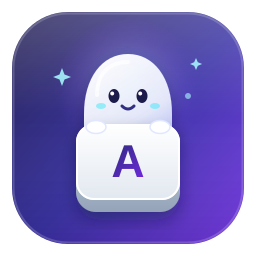

<div align="center">



# KeyGhost

**The invisible macOS keyboard ghost that snaps your input source back to English every time you switch apps.**

*Tiny (~60 KB) · Zero Permissions · No Menu Bar Clutter · Apple Silicon & Intel*

[](https://github.com/Lihaila/keyghost)
[](https://github.com/Lihaila/keyghost/releases)
[](https://github.com/Lihaila/keyghost/actions/workflows/ci.yml)
[](./LICENSE)

**English** | [简体中文](./README_zh.md)

</div>

---

## ✨ Why KeyGhost?

If you type in **Chinese, Japanese, Korean, Russian, Arabic, Thai, or any other non-English input method** on macOS (including third-party IMEs like Sogou, WeChat IME, or Rime), you know the pain: you finish replying to a message in a chat app, switch back to your terminal, IDE, or browser, start typing a command or shortcut—and accidentally type a string of non-English characters.

**KeyGhost** haunts your background quietly and natively:

| Feature | 👻 KeyGhost | Typical GUI Switchers |
| :--- | :---: | :---: |
| **Accessibility / Input Monitoring Permission** | ❌ Not needed | ✅ Required |
| **Menu Bar / Dock Icon** | Invisible | Always visible |
| **Binary Size** | ~60 KB | 10 – 50 MB |
| **Memory Usage** | < 3 MB | 30 – 100 MB |
| **Install Time** | 10 seconds (1 command) | Download, drag, grant permissions |
| **Privacy** | Never reads keystrokes | Often requires Input Monitoring |

---

## 🚀 10-Second Install (Beginner Friendly)

No Xcode, no Git, no settings to tweak.

1. Press **`⌘ Command + Space`**, type **`Terminal`**, and press **`Enter`**.
2. Paste the command below and press **`Enter`**:

```bash
curl -fsSL https://raw.githubusercontent.com/Lihaila/keyghost/main/scripts/quick-install.sh | bash
```

3. **Done!** KeyGhost starts immediately and launches automatically every time you log in.

> **How to verify it works:** Switch to Chinese/Japanese/Korean in any app, then click into another app — your input source in the top-right menu bar will instantly switch back to **ABC / U.S.**

### Uninstall Anytime

Open **Terminal** and run:

```bash
curl -fsSL https://raw.githubusercontent.com/Lihaila/keyghost/main/scripts/uninstall.sh | bash
```

*(Add `| bash -s -- --purge` if you also want to delete your optional config file.)*

---

## ⚙️ Optional Configuration

Works out of the box with zero configuration — automatically detects `ABC`, `U.S.`, or `British`, and falls back to your first enabled ASCII-capable keyboard layout (e.g. German, French, Dvorak, Colemak) if none of those are enabled.

If you want to **exclude specific apps** (e.g., keep Chinese when switching to WeChat) or choose a specific keyboard layout, create `~/.config/keyghost/config.json`:

```json
{
  "targetInputSource": "com.apple.keylayout.ABC",
  "excludedApps": [
    "com.tencent.xinWeChat"
  ],
  "switchOnWake": true
}
```

Changes take effect automatically on your next app switch — no restart needed.

<details>
<summary><b>📋 Common App Bundle IDs (click to expand)</b></summary>

| App | Bundle ID |
| :--- | :--- |
| WeChat (微信) | `com.tencent.xinWeChat` |
| WeCom (企业微信) | `com.tencent.WeWorkMac` |
| DingTalk (钉钉) | `com.alibaba.DingTalkMac` |
| Feishu / Lark (飞书) | `com.electron.lark` |
| QQ | `com.tencent.qq` |
| Apple Notes (备忘录) | `com.apple.Notes` |

Find any app's Bundle ID with:
```bash
osascript -e 'id of app "WeChat"'
```

Find all enabled keyboard input source IDs on your Mac with:
```bash
~/.local/bin/keyghost --list
```

</details>

---

## 🛠️ Build from Source

If you prefer inspecting and compiling the single Swift file yourself:

```bash
git clone https://github.com/Lihaila/keyghost.git
cd keyghost
make install
```

Useful `make` targets:
- `make build` — Compile `Sources/main.swift` to `build/keyghost`
- `make install` — Build, install, and start LaunchAgent
- `make status` — Check if KeyGhost is running
- `make list` — List all enabled keyboard input source IDs
- `make uninstall` — Stop and remove KeyGhost

---

## ❓ FAQ

<details>
<summary><b>Is it safe? Does it log my keystrokes?</b></summary>

**No.** The entire source code is ~200 lines in [`Sources/main.swift`](./Sources/main.swift). It never requests Accessibility or Input Monitoring permissions and cannot read what you type. It only listens for macOS's built-in "app switched" and "system woke" notifications and calls Apple's `TISSelectInputSource` API.

</details>

<details>
<summary><b>Will it keep working after I restart my Mac?</b></summary>

Yes. The installer sets up a standard macOS `LaunchAgent` (`~/Library/LaunchAgents/com.keyghost.agent.plist`), so it starts automatically whenever you log in.

</details>

<details>
<summary><b>Why doesn't macOS have this built in?</b></summary>

macOS only offers *"Automatically switch to a document's input source"*, which remembers the last input source per document/app instead of resetting to English. KeyGhost turns that option off and runs invisibly in the background so every app switch cleanly starts in English.

</details>

---

## 📄 License

[MIT](./LICENSE) © 2026 [Lihaila](https://github.com/Lihaila)
